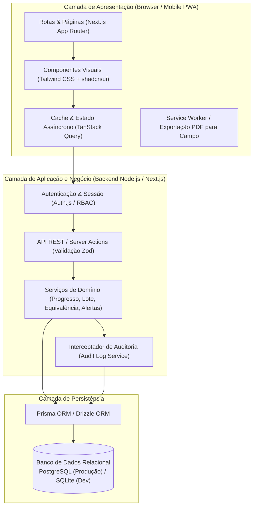
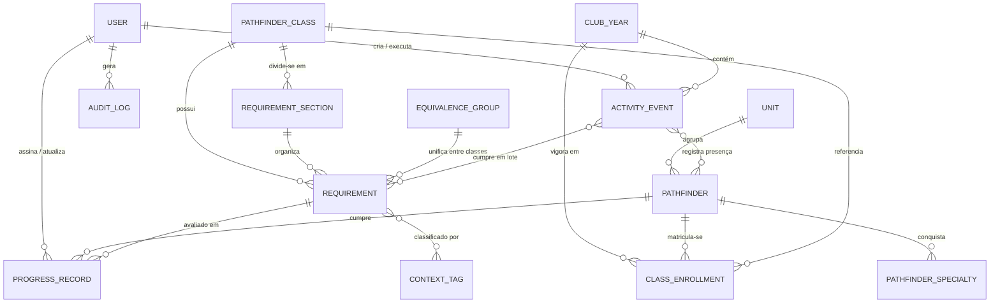

# Arquitetura do Sistema de Gestão de Classes e Atividades dos Desbravadores

> **Projeto:** Sistema Web de Planejamento e Acompanhamento de Cartões de Classes (Regulares e Avançadas)  
> **Diretório do Projeto:** `/config/Documentos/Projetos/desbravadores/gestao-classes`  
> **Foco:** Planejamento anual orientado à demanda real do clube, controle de progresso individual e em lote, governança entre líderes e auditoria completa.

---

## 1. Visão Geral e Objetivos do Produto

O sistema tem como objetivo transformar os **Cartões de Classes dos Desbravadores** (Amigo a Guia, nas modalidades Regular e Avançada) de listas estáticas individuais em uma **Matriz Dinâmica de Planejamento Anual para o Clube**.

### Principais Dores Resolvidas
1. **Falta de visão cruzada entre classes:** Instrutores planejam atividades isoladamente sem perceber que outras classes possuem requisitos equivalentes (ex: caminhadas, fogueiras, visitas comunitárias, especialidades).
2. **Trabalho manual repetitivo:** Marcar requisitos individualmente após um acampamento ou evento do clube toma muito tempo e gera erros.
3. **Perda de histórico e falta de rastreabilidade:** Dúvidas sobre *quem* assinou um requisito, *quando* foi cumprido e *qual* especialidade ou leitura específica foi usada para validar o item.
4. **Risco de Investidura:** Dificuldade em identificar rapidamente quais desbravadores estão próximos de fechar o cartão e quais requisitos são os maiores "gargalos" do clube no ano.

---

## 2. Arquitetura Técnica e Stack Tecnológica

A arquitetura foi desenhada seguindo o padrão **Monólito Modular Full-Stack (PWA Mobile-First)**, garantindo simplicidade de implantação, tipagem estrita de ponta a ponta, excelente desempenho em celulares (uso no cantinho da unidade/acampamento) e baixo custo de infraestrutura.



### Tecnologias Definidas
| Camada | Tecnologia | Justificativa para o Dia a Dia do Clube |
| :--- | :--- | :--- |
| **Framework Full-Stack** | **Next.js (App Router) + TypeScript** | Unifica frontend e backend no mesmo repositório, com validação de tipos do banco até a tela. |
| **Interface (UI/UX)** | **Tailwind CSS + shadcn/ui + Lucide Icons** | Componentes acessíveis, responsivos (Mobile-First) com tabelas ricas, filtros multi-seleção e modais rápidos. |
| **Validação de Dados** | **Zod + React Hook Form** | Garante que nenhum dado inválido entre na API ou no banco de dados. |
| **ORM & Banco de Dados** | **Prisma ORM + PostgreSQL (ou SQLite local)** | Facilita migrações de esquema, consultas relacionais complexas (agrupamentos por classe/requisito) e seed inicial de todos os cartões. |
| **Autenticação & Segurança** | **Auth.js (NextAuth) + bcrypt** | Gestão de sessões seguras via JWT/Cookies e controle de permissões por cargo (RBAC). |
| **Relatórios / Impressão** | **React-PDF / CSS Print Media** | Gera listas de chamada e fichas de campo para acampamentos onde não há sinal de internet. |

---

## 3. Modelagem do Banco de Dados (Esquema Relacional)

O modelo relacional separa claramente o **Catálogo Oficial da DSA** (Classes, Seções, Requisitos, Especialidades e Equivalências) da **Operação Anual do Clube** (Anos Letivos, Unidades, Desbravadores, Matrículas, Progresso e Auditoria).



### Detalhamento das Tabelas Principais

#### 3.1. Gestão de Usuários e Liderança (`users`, `user_scopes`)
* **`users`**:
  * `id` (UUID, PK)
  * `name` (String) — Nome completo do líder.
  * `email` (String, Unique) — Login do líder.
  * `password_hash` (String) — Senha criptografada.
  * `role` (Enum) — `ADMIN` | `DIRETOR` | `SECRETARIO` | `INSTRUTOR` | `CONSELHEIRO`.
  * `active` (Boolean) — Permite desativar líderes de anos anteriores sem perder o histórico de quem assinou os cartões no passado.
  * `created_at`, `updated_at` (Timestamp).
* **`user_scopes`** (Vínculo de atuação do líder no ano):
  * Vincula um `INSTRUTOR` às suas classes específicas (ex: Instrutor de Companheiro e Pesquisador) e um `CONSELHEIRO` à sua Unidade específica (ex: Unidade Águias).

#### 3.2. Catálogo de Classes, Requisitos e Categorias (`pathfinder_classes`, `requirement_sections`, `requirements`, `context_tags`, `equivalence_groups`)
* **`pathfinder_classes`**:
  * `id` (UUID, PK)
  * `slug` (String) — Ex: `amigo`, `amigo-avancado`, `companheiro`, `companheiro-avancado`, `pesquisador`, `pioneiro`, `excursionista`, `guia` (e suporte a Classes Agrupadas).
  * `name` (String) — Nome de exibição.
  * `type` (Enum) — `REGULAR` | `AVANCADA` | `AGRUPADA`.
  * `min_age` (Int) — Idade mínima oficial (10 a 15 anos).
  * `color_hex` (String) — Cor oficial da classe (Azul, Vermelho, Verde, Cinza, Vinho, Amarelo) para identificação visual imediata na UI.
  * `display_order` (Int).
* **`requirement_sections`** (As seções oficiais do cartão):
  * Ex: `I. Gerais`, `II. Descoberta Espiritual`, `III. Servindo a Outros`, `IV. Desenvolvendo Amizade`, `V. Saúde e Aptidão Física`, `VI. Organização e Liderança`, `VII. Estudo da Natureza`, `VIII. Arte de Acampar`, `IX. Estilo de Vida`.
* **`equivalence_groups`** (Inovação para Planejamento Integrado):
  * `id` (UUID, PK)
  * `title` (String) — Ex: *"Caminhada / Excursionismo a Pé"*, *"Pernoite / Acampamento"*, *"Fogueiras e Cozinha Mateira"*, *"Ano Bíblico"*, *"Projeto Comunitário"*.
  * `description` (Text) — Explicação de como realizar a atividade unificando várias classes no mesmo evento.
* **`requirements`**:
  * `id` (UUID, PK)
  * `class_id` (FK -> `pathfinder_classes`)
  * `section_id` (FK -> `requirement_sections`)
  * `equivalence_group_id` (FK opcional -> `equivalence_groups`)
  * `parent_id` (FK opcional -> `requirements`) — Para sub-itens (ex: Requisito `IV.2` que possui `a)` e `b)`).
  * `code` (String) — Código no cartão (ex: `II.3`, `VIII.4.a`).
  * `title` (String) — Resumo curto para tabelas e filtros.
  * `description` (Text) — Texto integral exigido pelo cartão oficial da DSA.
  * `execution_type` (Enum):
    * `ATIVIDADE_PRATICA` (Feito em reunião/acampamento)
    * `TEORICO_SALA` (Debate, estudo no cantinho da classe)
    * `ESPECIALIDADE_FIXA` (Exige uma especialidade específica, ex: *Natação Principiante I*)
    * `ESPECIALIDADE_ESCOLHA` (Exige escolher 1 especialidade dentro de uma área, ex: *Estudo da Natureza*)
    * `ACOMPANHAMENTO_LONGO` (Ex: Ano Bíblico, leitura do livro do Curso de Leitura, manter diário por X semanas)
  * `required_specialty_area` / `required_specialty_id` (Opcional).
* **`context_tags`** e **`requirement_tags`** (Relação N:N):
  * Tags práticas para o filtro dinâmico da diretoria:
    * **Local:** `Ao Ar Livre / Mato`, `Sede / Escola`, `Igreja`, `Comunidade / Rua`, `Em Casa`.
    * **Formato:** `Acampamento`, `Caminhada`, `Fogueira`, `Especialidade`, `Concurso / Prova`, `Leitura`.
    * **Recursos:** `Requer Instrutor Especialista`, `Requer Materiais/Cabos`, `Sem Custo`.

#### 3.3. Desbravadores, Unidades e Matrículas (`units`, `pathfinders`, `club_years`, `class_enrollments`)
* **`units`**: `id`, `name`, `gender` (`MASCULINO` | `FEMININO`), `active`.
* **`pathfinders`**: `id`, `name`, `birth_date`, `unit_id`, `photo_url`, `notes`, `active`.
* **`club_years`**: `id`, `year` (ex: `2026`), `is_current` (Boolean), `investiture_target_date` (Date).
* **`class_enrollments`** (Matrícula do Desbravador na Classe):
  * `id` (UUID, PK)
  * `pathfinder_id` (FK)
  * `class_id` (FK)
  * `club_year_id` (FK)
  * `instructor_id` (FK opcional -> `users`)
  * `status` (Enum) — `EM_ANDAMENTO` | `APTO_INVESTIDURA` | `INVESTIDO` | `PAUSADO`.
  * *Nota:* Permite que um desbravador faça a classe Regular + Avançada simultaneamente, ou recupere uma classe atrasada (Classes Agrupadas).

#### 3.4. Controle de Progresso e Eventos em Lote (`progress_records`, `activity_events`)
* **`progress_records`**:
  * `id` (UUID, PK)
  * `pathfinder_id` (FK -> `pathfinders`)
  * `requirement_id` (FK -> `requirements`)
  * `enrollment_id` (FK -> `class_enrollments`)
  * `status` (Enum):
    * `PENDENTE` (0% - Ainda não começou)
    * `EM_ANDAMENTO` (Iniciado, ex: lendo o livro ou cumprindo partes)
    * `CONCLUIDO_CONSELHEIRO` (Feito, aguardando conferência/assinatura final do instrutor/diretor)
    * `APROVADO` (100% Assinado e validado para investidura)
  * `progress_percent` (Int, default 0..100) — Útil para Ano Bíblico ou leitura.
  * `completed_at` (Date) — Data em que a atividade foi realizada.
  * `marked_by_user_id` (FK -> `users`) — Quem marcou como concluído.
  * `approved_by_user_id` (FK -> `users`) — Quem deu a assinatura final.
  * `activity_event_id` (FK opcional -> `activity_events`) — Se foi aprovado através de um evento em lote.
  * `evidence_notes` (Text) — Observações (ex: *"Escolheu a especialidade de Felinos"*, *"Lido o livro Pela Graça de Deus"*).
* **`activity_events`** (Assinatura em Lote / Planejamento do Calendário):
  * `id` (UUID, PK)
  * `club_year_id` (FK)
  * `title` (String) — Ex: *"Acampamento de Inverno 2026"* ou *"Domingo de Nós e Amarras"*.
  * `scheduled_date` (Date)
  * `status` (Enum) — `PLANEJADO` | `REALIZADO` | `CANCELADO`.
  * `created_by_user_id` (FK -> `users`)
  * Tabelas associativas: `activity_event_requirements` (quais requisitos serão cumpridos neste evento) e `activity_event_attendees` (quais desbravadores participaram).

#### 3.5. Auditoria e Logs de Usuários (`audit_logs`)
* **`audit_logs`** (Tabela Append-Only / Imutável):
  * `id` (UUID, PK)
  * `user_id` (FK -> `users`) — Líder que executou a ação.
  * `user_name_snapshot` (String) — Nome do líder gravado no momento da ação.
  * `user_role_snapshot` (String) — Cargo do líder no momento da ação.
  * `action` (Enum) — `STATUS_CHANGE` | `BULK_EVENT_APPROVE` | `ENROLLMENT_CREATE` | `PATHFINDER_UPDATE` | `USER_PERMISSION_CHANGE` | `REVERT_ACTION`.
  * `entity_type` (String) — Ex: `PROGRESS_RECORD`, `ACTIVITY_EVENT`, `PATHFINDER`.
  * `entity_id` (UUID)
  * `batch_id` (UUID opcional) — Agrupa todas as alterações feitas em um único clique de "Aprovação em Lote", permitindo desfazer ou auditar o lote inteiro.
  * `summary` (String) — Texto legível para humanos: *"Líder Carlos aprovou o requisito VIII.2 (Amigo) para Pedro Henrique"*.
  * `previous_state` (JSONB) — Estado anterior do registro.
  * `new_state` (JSONB) — Novo estado do registro.
  * `ip_address` / `user_agent` (String)
  * `created_at` (Timestamp, Indexado).

---

## 4. Regras de Negócio, Permissões (RBAC) e Governança

Para dar segurança de produção no dia a dia do clube, cada perfil de líder possui permissões claras:

| Funcionalidade | Diretor / Admin | Secretário(a) | Instrutor de Classe | Conselheiro de Unidade |
| :--- | :---: | :---: | :---: | :---: |
| Visualizar Painel de Demanda Anual (Filtros) | ✅ Total | ✅ Total | ✅ Total | ✅ Total |
| Gerenciar Líderes e Permissões | ✅ | ❌ | ❌ | ❌ |
| Cadastrar Desbravadores, Unidades e Matrículas | ✅ | ✅ | ❌ | ❌ |
| Marcar requisito como `EM_ANDAMENTO` ou `CONCLUIDO` | ✅ Todos | ✅ Todos | ✅ Sua(s) Classe(s) | ✅ Sua Unidade |
| Dar assinatura final (`APROVADO`) no cartão | ✅ Todos | ✅ Todos | ✅ Sua(s) Classe(s) | ⚙️ Configurável* |
| Criar/Executar Evento em Lote (Acampamento/Reunião) | ✅ Todos | ✅ Todos | ✅ Sua(s) Classe(s) | ❌ |
| Visualizar Histórico de Auditoria (`Audit Logs`) | ✅ Completo | ✅ Completo | ✅ Da sua classe | ❌ |
| Reverter alteração acidental no Log | ✅ | ❌ | ❌ | ❌ |

> *\*Nota sobre Conselheiros:* O clube pode configurar uma chave geral (`allow_counselor_direct_approval`). Se ativada, o conselheiro já aprova direto; se desativada, o conselheiro marca como "Feito" e o Instrutor/Diretor apenas revisa uma fila de pendências e aprova com 1 clique.

---

## 5. Fluxos Principais e Telas da Aplicação

### 5.1. Matriz de Demanda do Clube (A Tela Central de Planejamento)
Esta tela responde à pergunta: **"O que o nosso clube ainda precisa fazer este ano?"**
* **Filtros Combináveis no Topo:**
  * **Modalidade:** `Todas` | `Apenas Classes Regulares` | `Apenas Classes Avançadas`
  * **Classes:** `Amigo`, `Companheiro`, `Pesquisador`, `Pioneiro`, `Excursionista`, `Guia`
  * **Contexto / Local (Tags):** `Ao Ar Livre`, `Acampamento`, `Igreja`, `Comunidade`, `Especialidades`, `Reunião Regular`
  * **Seção do Cartão:** `Descoberta Espiritual`, `Arte de Acampar`, `Estudo da Natureza`, etc.
  * **Agrupamento:** `Ver por Requisito Individual` vs. `Agrupar por Equivalência Inter-classes` (Ex: junta todas as caminhadas de todas as classes em um único card).
* **Resultado em Lista Dinâmica:**
  * Mostra cada atividade com um **Contador de Demanda** (ex: 🔴 **18 desbravadores pendentes** de 22 matriculados).
  * Ao clicar para expandir a atividade, exibe a lista exata de **quais desbravadores** (separados por classe/unidade) ainda precisam fazer aquele item.
  * Botão direto na linha: **`[+ Agendar Atividade]`** ou **`[✓ Dar Baixa em Lote]`**.

### 5.2. Assinatura em Lote ("Modo Evento / Reunião")
Fluxo pensado para economizar horas de trabalho após um domingo de clube ou acampamento:
1. O líder clica em **"Registrar Atividade Realizada"**.
2. Seleciona a data e os requisitos trabalhados (ex: pesquisando por tag `Fogueira` e selecionando os itens correspondentes de Amigo, Companheiro e Pioneiro).
3. O sistema lista automaticamente todos os desbravadores matriculados nessas classes que ainda estavam `PENDENTES`.
4. O líder desmarca apenas quem faltou (ou seleciona os presentes), adiciona uma observação opcional (ex: *"Realizado no Acampamento da Fazenda São João"*) e clica em **Confirmar**.
5. O sistema atualiza dezenas de cartões em uma única transação atômica e gera o registro no Log de Auditoria com `batch_id`.

### 5.3. Visão Planilha da Classe (Matriz Instrutor)
* Visão estilo grade onde:
  * **Linhas:** Todos os requisitos da Classe Regular e da Classe Avançada (divididos por seção).
  * **Colunas:** Os desbravadores matriculados naquela classe.
  * **Células:** Ícones interativos de status (⚪ Pendente, 🟡 Em andamento, 🔵 Aguardando aprovação, 🟢 Aprovado).
* Permite ao instrutor bater o olho e ver qual desbravador ficou para trás em um requisito já dado em aula (para aplicar reposição).

### 5.4. Painel de Investidura e Alertas (Termômetro do Clube)
* Gráfico de progresso geral do clube rumo à investidura.
* **Semáforo dos Desbravadores:**
  * 🟢 **Prontos / Quase Prontos (>85%):** Lista quem só precisa de 1 ou 2 requisitos para fechar o cartão (foco prioritário na reta final do ano).
  * 🟡 **No Ritmo (50% a 84%):** Acompanhamento normal.
  * 🔴 **Em Risco (<50%):** Desbravadores com muitas faltas ou pendências acumuladas.

### 5.5. Painel de Auditoria e Histórico (Logs)
* Linha do tempo pesquisável por: **Líder**, **Desbravador**, **Classe**, **Tipo de Ação** e **Período**.
* Exibe exatamente o antes e o depois de cada marcação, garantindo transparência total entre Diretoria, Secretaria, Instrutores e Regional.

---

## 6. Estrutura de Pastas do Projeto (`gestao-classes/`)

O código será organizado de forma limpa e modular dentro de `/config/Documentos/Projetos/desbravadores/gestao-classes`:

```text
gestao-classes/
├── docs/
│   ├── ARQUITETURA.md                # Este documento de arquitetura
│   └── CATALOGO_CLASSES.md           # Mapeamento dos requisitos das classes regulares e avançadas
├── prisma/
│   ├── schema.prisma                 # Esquema do banco de dados relacional
│   ├── migrations/                   # Histórico de evolução do banco
│   └── seed/                         # Scripts para popular os cartões oficiais automaticamente
│       ├── index.ts
│       ├── classes-regulares.ts      # Requisitos Amigo a Guia
│       ├── classes-avancadas.ts      # Requisitos Amigo da Natureza a Guia de Exploração
│       └── equivalencias-tags.ts     # Grupos de equivalência e tags (Ar Livre, Igreja, etc.)
├── src/
│   ├── app/                          # Rotas e Páginas (Next.js App Router)
│   │   ├── (auth)/login/             # Tela de login dos líderes
│   │   ├── (dashboard)/
│   │   │   ├── page.tsx              # Visão Geral & Termômetro de Investidura
│   │   │   ├── planejamento/         # Matriz de Demanda Dinâmica (Filtros por Atividade/Local)
│   │   │   ├── classes/[slug]/       # Grade da Classe (Desbravador x Requisito)
│   │   │   ├── desbravadores/        # Cadastro e Cartão Virtual Individual
│   │   │   ├── eventos-lote/         # Planejamento e Assinatura em Lote
│   │   │   ├── lideres/              # Gestão de Usuários e Permissões (RBAC)
│   │   │   └── auditoria/            # Histórico completo de mudanças (Audit Logs)
│   │   └── api/                      # Endpoints REST / Route Handlers
│   ├── components/
│   │   ├── ui/                       # Componentes base (Botões, Tabelas, Filtros, Modais)
│   │   ├── planning/                 # Componentes da Matriz de Demanda e Filtros
│   │   ├── class-matrix/             # Grade interativa do cartão
│   │   └── audit/                    # Visualizador de logs e diffs
│   ├── lib/
│   │   ├── db.ts                     # Instância do banco de dados
│   │   ├── auth.ts                   # Configuração de autenticação e verificação de cargos
│   │   ├── audit.ts                  # Helper centralizado que grava logs automaticamente
│   │   └── validations/              # Schemas Zod para formulários e API
│   └── services/                     # Regras de negócio isoladas da interface
│       ├── demand-planning.service.ts
│       ├── progress.service.ts
│       ├── bulk-approval.service.ts
│       └── investiture-risk.service.ts
├── public/                           # Ícones das classes, insígnias e manifesto PWA
├── package.json
└── tsconfig.json
```

---

## 7. Roadmap de Implementação (Fases de Entrega)

Para colocarmos o sistema no ar de forma organizada e testável:

1. **Fase 1 — Fundação, Banco de Dados e Catálogo de Cartões (Seed):**
   * Inicialização do projeto em `gestao-classes/`.
   * Criação do banco de dados com todas as tabelas (Usuários, Desbravadores, Classes, Requisitos, Tags, Grupos de Equivalência, Progresso e Audit Log).
   * Criação do **Seed Inicial** com os cartões das Classes Regulares e Avançadas já categorizados e tagueados (`Ao Ar Livre`, `Igreja`, `Especialidade`, etc.).
2. **Fase 2 — Autenticação, Perfis de Líderes e Auditoria:**
   * Sistema de Login, controle de cargos (Diretor, Secretário, Instrutor, Conselheiro) e serviço automático de gravação de logs de auditoria.
   * Cadastro de Unidades, Desbravadores e Matrículas nas classes do ano.
3. **Fase 3 — Matriz de Demanda Dinâmica e Assinatura de Cartões:**
   * Construção da tela principal de **Planejamento por Demanda** (com filtros por categoria, local, classe e contagem de desbravadores pendentes).
   * Construção da **Grade da Classe** (marcação rápida individual) e do **Modo Evento / Assinatura em Lote**.
4. **Fase 4 — Termômetro de Investidura, Exportação PDF e Refinamento Mobile:**
   * Painel de alertas de investidura, visualização do histórico de logs e relatórios para impressão de campo.
